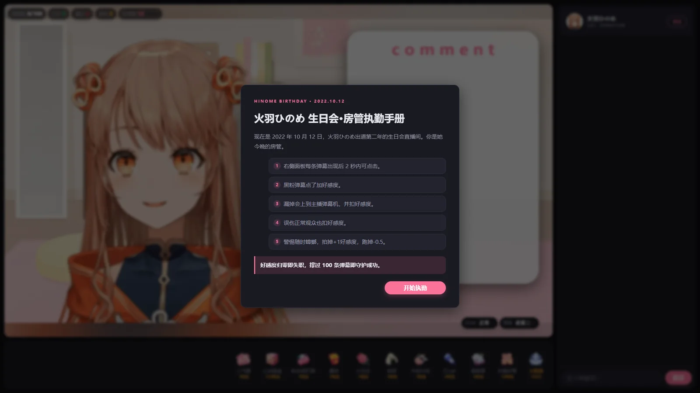
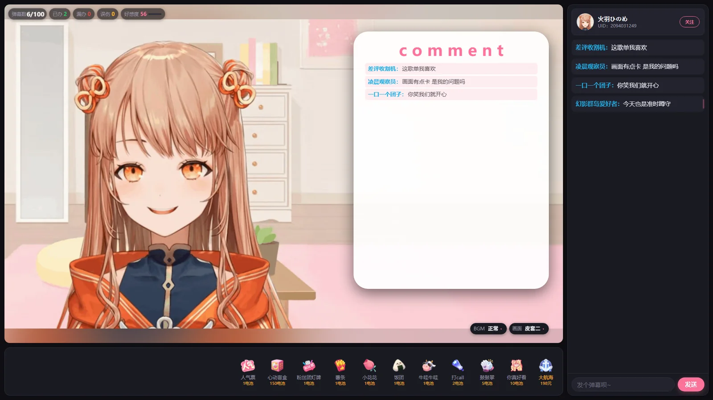
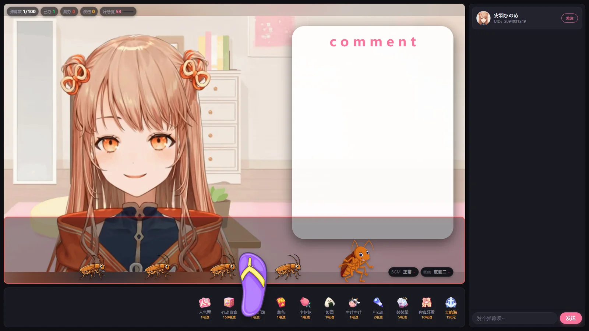
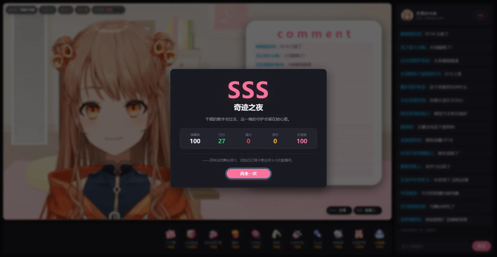

# 守护火羽 · 千舰之夜

> 一个以 B 站 Vtuber **火羽ひのめ** 2022 年生日会为背景的房管模拟网页小游戏。

玩家将穿越回 **2022 年 10 月 12 日** 的生日会直播间，担任火羽ひのめ的房管：在弹幕进入主播弹幕机之前，判断并处理黑粉弹幕，同时应付不定期钻进直播画面的蟑螂，守护这一晚的直播间。

本项目为粉丝向同人作品，纯静态实现，**无需服务端、无需构建、零第三方依赖**，双击 `index.html` 即可游玩。

## 项目简介

- **核心玩法**：右侧操作面板会不断出现弹幕，负面弹幕只会在有限时间内可点击；漏掉会进入主播弹幕机并扣好感度。
- **完整对局**：一局 100 条弹幕，分为三个难度阶段；好感度归零立即失败，撑到最后按好感度评级。
- **直播画面**：内置三套皮套（GIF + 柔化补边），PC 端填满左栏，移动端保持 16:9。
- **背景音乐**：三首可循环 BGM（正常 / 魔性 / 洗脑），游戏中随时切换，带交叉淡入淡出。
- **额外玩法**：每局随机出现三轮蟑螂入侵，用拖鞋拍掉可加分，逃跑会扣分。
- **主播卡**：点击头像可在新标签页打开火羽ひのめ的 B 站个人空间。
- **响应式**：PC 双栏布局，移动端单列布局；移动端支持手指直接点蟑螂。

## 游戏截图

以下截图均为游戏实际画面:

| 教程与规则 | 直播主界面 |
| :---: | :---: |
| [](docs/screenshots/01-tutorial.webp) | [](docs/screenshots/02-gameplay.webp) |
| 首次进入时的房管执勤手册，包含判定、好感度与蟑螂规则。 | 直播画面、主播弹幕机、统计条、礼物栏，以及画面 / BGM 切换胶囊。 |

| 拍蟑螂玩法 | 结算评级 |
| :---: | :---: |
| [](docs/screenshots/03-roach-invasion.webp) | [](docs/screenshots/04-result.webp) |
| 底部入侵区域、头领与小蟑螂队列，以及鞋面前掌的拖鞋光标。 | 对局结束后展示评级、称号、统计与通关彩蛋。 |

## 快速开始

无服务端、无构建、零第三方依赖：

1. 下载或克隆本仓库；
2. 双击根目录的 `index.html` 即可开始游玩。

项目直接使用 `file://` 协议运行，不需要 `npm install`，也不需要启动本地服务器。若浏览器对 `file://` 有限制，也可以用任意静态文件服务器托管仓库根目录。

> 浏览器通常要求用户先进行一次交互才允许播放音频，因此 BGM 会在首次点击后正常播放。

## 核心玩法

### 判定规则

右侧操作面板中的每条弹幕出现后，默认有 **2 秒** 的可点击时间。超过窗口后，弹幕会同步到直播画面内的「主播弹幕机」，不再可操作。

| 玩家行为 | 好感度 | 连击 | 说明 |
| --- | ---: | --- | --- |
| 点掉负面弹幕（黑粉） | **+3** | +1 | 连击达到 5 后，本次收益变为 **+4** |
| 漏掉负面弹幕 | **−8** | 清零 | 负面弹幕会以红色气泡进入主播弹幕机 |
| 误伤正常弹幕（含陷阱） | **−5** | 清零 | 正常观众、普通互动与陷阱弹幕都属于非负面 |
| 拍死蟑螂 | **+1** | 不变 | 入侵期间即时结算 |
| 蟑螂逃跑 | **−0.5 / 只** | 不变 | 本轮入侵结束时统一结算 |

- 初始好感度为 **50**，归零立即失败。
- 通关条件：**完整处理 100 条弹幕**。
- 好感度上限为 100，超过部分会被截断。

### 难度阶段

| 阶段 | 弹幕序号 | 负面弹幕占比 | 出弹幕间隔 |
| --- | ---: | ---: | ---: |
| 第一阶段 | 1–30 | 15% | 2.8s ± 0.8s |
| 第二阶段 | 31–70 | 28% | 2.8s ± 0.8s |
| 第三阶段 | 71–100 | 35% | 2.4s ± 0.6s |

三个阶段内部会随机打乱弹幕内容，并按阶段递进增加黑粉比例。完整一局约 4–5 分钟。

### 评级

| 评级 | 好感度 | 称号 |
| --- | ---: | --- |
| SSS | ≥ 95 | 奇迹之夜 |
| S | ≥ 85 | 金牌房管 |
| A | ≥ 70 | 信赖之壁 |
| B | ≥ 55 | 合格房管 |
| C | ≥ 40 | 勉强合格 |
| D | ≥ 1 | 初出茅庐 |
| F | ≤ 0 | 房管不合格 |

## 操作方式

| 操作 | 说明 |
| --- | --- |
| 鼠标左键 / 触屏点击 | 点击操作面板中的弹幕进行判定 |
| 鼠标左键 / 触屏点击 | 蟑螂入侵时拍击蟑螂；PC 显示拖鞋光标，移动端直接手指点击 |
| 「BGM」下拉 | 切换正常 / 魔性 / 洗脑三首背景音乐 |
| 「画面」下拉 | 切换皮套一 / 皮套二 / 皮套三 |
| 主播卡头像 | 新标签页打开火羽ひのめ的 B 站个人空间 |
| 切换浏览器标签 | 自动暂停对局、计时与 BGM，返回后继续 |

## 直播画面、BGM 与主播卡

- 三套直播画面均已内置，默认使用 **皮套二**；切换时先预加载目标皮肤，再替换可见画面，避免白屏。
- PC 端直播屏填满左栏，与礼物栏等宽；主画面按比例居中，两侧和上下由同套皮肤的柔化底图补齐。
- 移动端保持 **16:9** 比例与左右 **8px** 边距，主播卡与礼物栏隐藏，保留直播、统计、弹幕面板与输入栏。
- 右下角「BGM」与「画面」共用同一套深色胶囊和下拉选项样式。
- BGM 共计三首：
  - `bgm_1.mp3` — 正常
  - `bgm_2.wav` — 魔性
  - `bgm_3.wav` — 洗脑
- 三首曲目全部预加载并循环播放，切换时使用约 **220ms** 交叉淡入淡出；切换不会重置对局。
- 主播卡头像为 `target="_blank"` 链接，点击后在新标签页打开火羽ひのめ的 B 站个人空间。

## 拍蟑螂玩法

- 每局在约第 15–78 条弹幕之间随机触发 **3 轮** 蟑螂入侵。
- 每轮 **1 只头领 + 4 只小蟑螂**，从直播画面底部的红框区域左侧进入，约 10 秒内从右侧离开。
- 五只蟑螂按出生顺序排队，保持最小间距，不会互相追尾。
- 头领进入时播放一次 `whistle`，随后循环 `drumbeat` + `cockroach_footsteps`；最后一只离开或死亡后停止，区域淡出。
- PC 端鼠标进入直播画面或礼物区会显示拖鞋光标；**鞋面前掌的白点是真实命中点**，整张蟑螂行走图额外放宽 12px 判定。
- 移动端不显示拖鞋，直接用手指点击蟑螂。
- 每拍死一只 **+1** 好感；本轮结束时，每跑掉一只 **−0.5** 好感。
- 入侵区域覆盖在弹幕机和画面/BGM 胶囊上层；弹幕机保持原高度，不改变布局。
- 入侵区域四角与直播画面使用同一套 14px 圆角。

## 项目结构

```text
mygame/
├─ index.html                    # 入口页面，双击即玩
├─ README.md                     # 项目说明
├─ LICENSE                       # MIT 许可证
├─ docs/
│  └─ screenshots/               # README 展示截图（WebP）
└─ public/
   ├─ css/                       # main / layout / live / panel / modal
   ├─ js/                        # main / game / favor / ui-live / ui-panel / audio / roach
   ├─ data/                      # config / comments / danmaku-positive / danmaku-negative / audience
   ├─ images/                    # 三套直播画面与底图、主播头像、礼物图标、蟑螂素材
   └─ audio/                     # bgm_1.mp3、bgm_2.wav、bgm_3.wav、正误音效、蟑螂音效
```

## 数据与自定义

游戏内容均为本地数据文件，直接编辑 `public/data/` 下对应的 `.js` 文件即可，刷新页面后生效，无需重新构建。

| 想修改的内容 | 文件 |
| --- | --- |
| 好感度、出弹幕间隔、阶段占比、评级档位 | `public/data/config.js` |
| BGM 曲目、默认 BGM、音量 | `public/data/config.js` |
| 三套皮套与默认画面 | `public/data/config.js` |
| 蟑螂轮次、触发区间、移动时长、间距、得分 | `public/data/config.js` |
| 通关 / 失败副标题、通关彩蛋 | `public/data/comments.js` |
| 应援 / 普通 / 陷阱弹幕库 | `public/data/danmaku-positive.js` |
| 黑粉弹幕库 | `public/data/danmaku-negative.js` |
| 观众昵称与身份属性 | `public/data/audience.js` |

> 观众等级、舰长、灯牌等属性目前只随数据下发，不在界面中渲染，保留给后续扩展。

## 技术实现

- **零依赖纯静态**：HTML、CSS、JavaScript 分离，不依赖任何第三方库、构建工具或服务端。
- **file:// 兼容**：浏览器在 `file://` 下会拦截 `fetch()` 与 ES Module，因此本地数据统一采用 `.js` 包裹 JSON，通过普通 `<script defer>` 按序加载。
- **全局命名空间**：所有逻辑挂载于单一 `HMG` 命名空间，避免全局污染。
- **本地存储**：教程已读标记写入 `localStorage`，键为 `hinome_mod_seen_v1`，带异常兜底；清除浏览器数据后可重新查看教程。
- **响应式布局**：PC 双栏，移动端单列；舞台尺寸由 JS 依据可用空间计算，并用柔化底图补齐宽屏比例。
- **三皮套预加载**：切换时先加载目标 GIF，再替换可见画面，避免白屏。
- **BGM 管理**：三首曲目预加载、循环播放，切换使用 220ms 交叉淡入淡出，并随页面可见性暂停 / 恢复。
- **拍蟑螂**：独立 `requestAnimationFrame` 时间轴，随对局暂停 / 恢复；拖鞋为 DOM 跟随层；蟑螂位置按区域宽度实时计算，队列间距约束，溢出裁剪。
- **可访问性**：使用语义化按钮与标签、弹窗 `role="dialog"`、键盘焦点样式；支持 `prefers-reduced-motion` 降低动效。

## 兼容性与已知限制

- 目标为现代 Chrome、Edge、Firefox、Safari 及移动端浏览器；当前主要在 Chrome / Edge 内核环境验证。
- 浏览器自动播放策略要求先进行一次用户交互，BGM 才会开始播放。
- `file://` 下的 `localStorage` 行为在不同浏览器中可能不同；若教程标记无法保存，仅影响是否重复展示教程。
- 首次打开需要读取本地直播 GIF、三首 BGM 与图片素材，素材总量较大；首次加载时间取决于磁盘与浏览器缓存。
- 对局总弹幕数、阶段边界等核心节奏目前为固定配置，修改 `config.js` 时需同步调整相关阶段数据。

## 素材与版权声明

- 本项目为粉丝向同人作品，仅供学习与娱乐，与哔哩哔哩及火羽ひのめ本人无官方关联。
- 项目内的直播画面、立绘、音频、礼物图标等素材版权归各自权利人所有，请勿用于商业用途。
- 游戏文案改编自公开报道的历史事件，相关叙事细节以现实为准。

## 许可证

本项目代码基于 [MIT License](./LICENSE) 开源。
